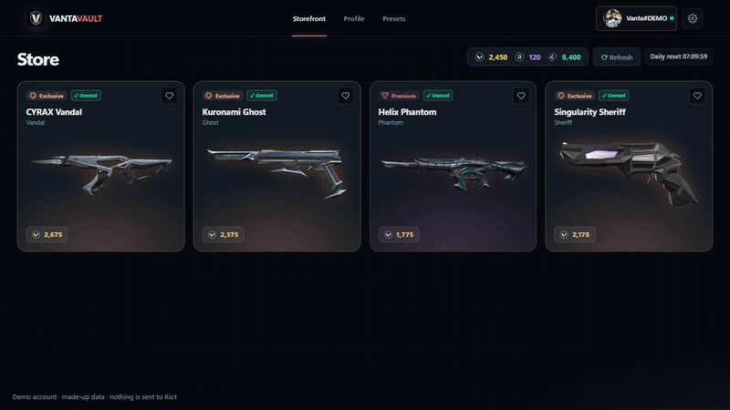
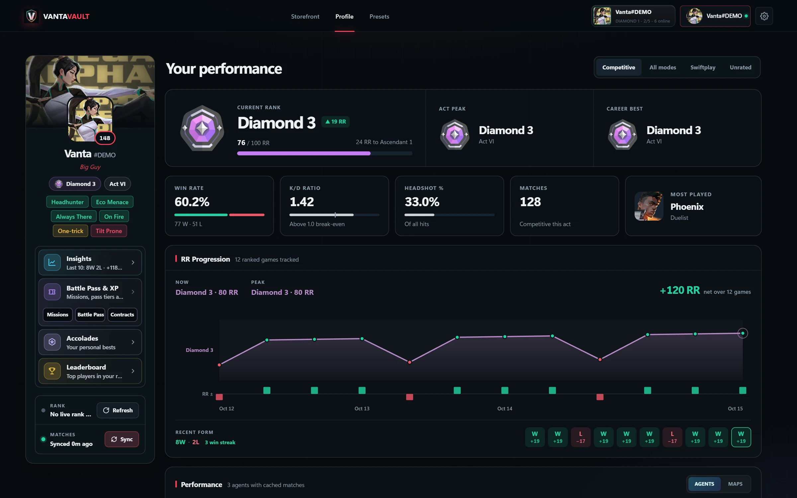
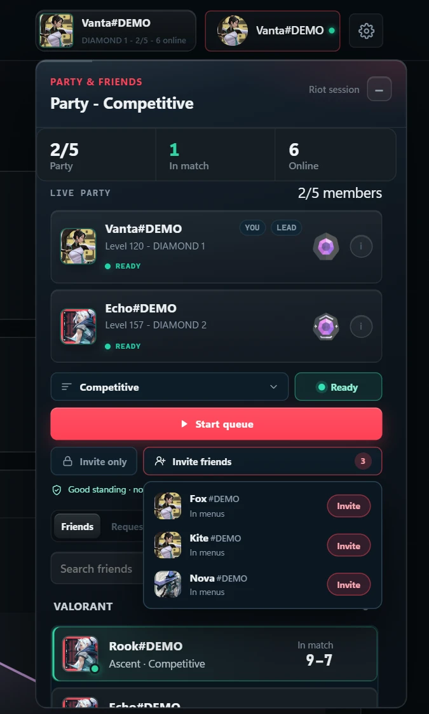
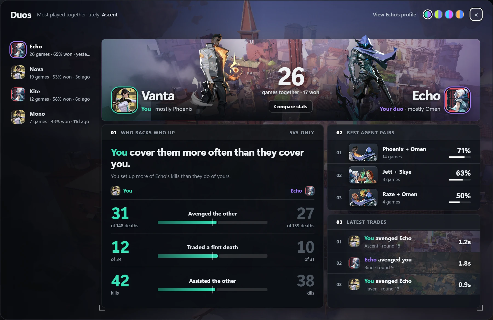
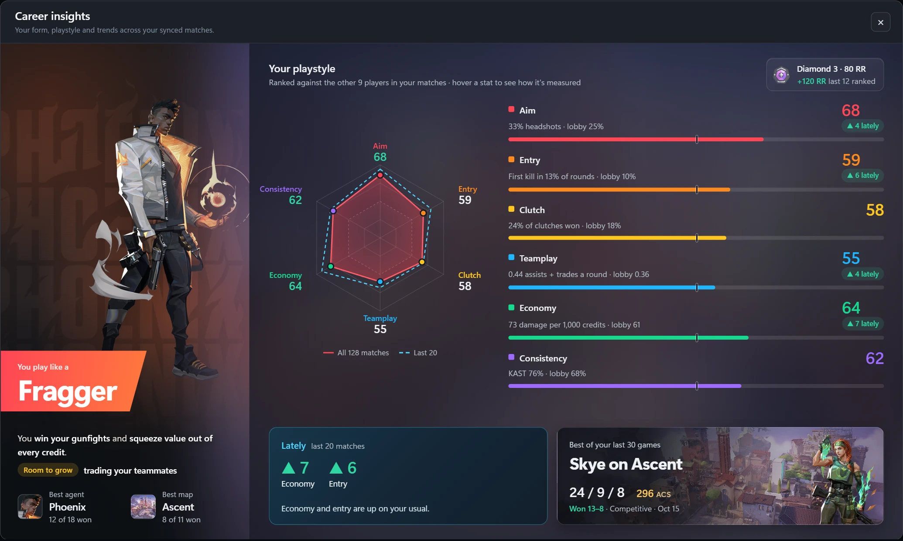
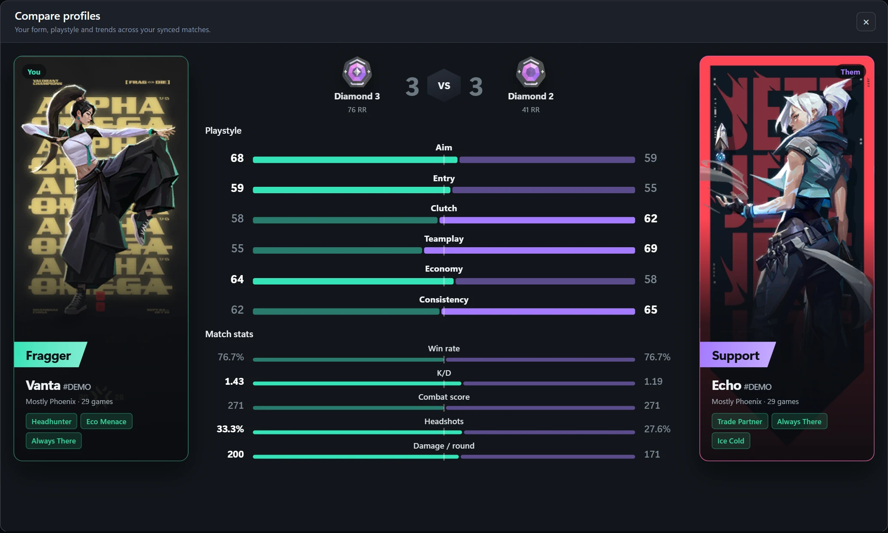
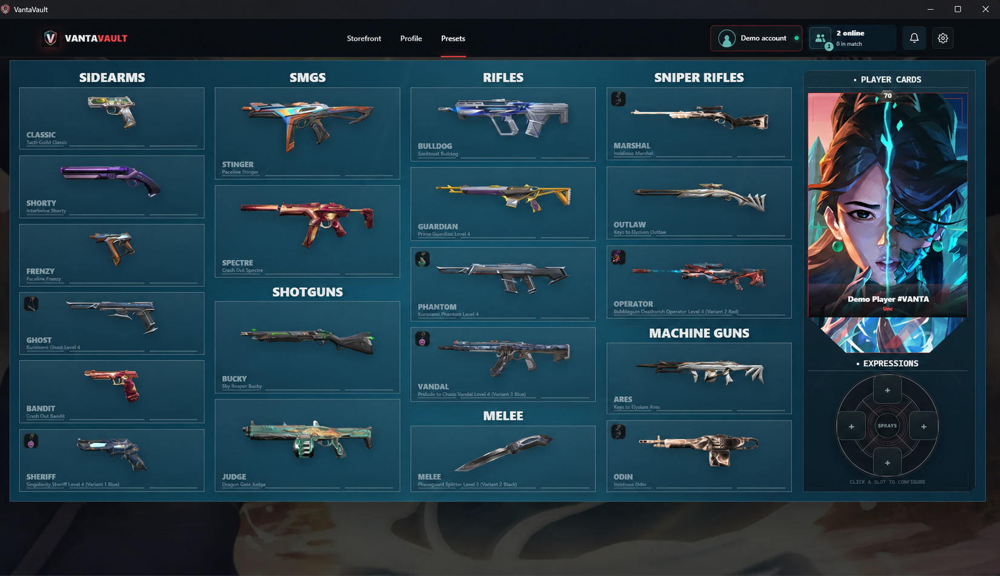

<div align="center">
  
  <h1>VantaVault</h1>
  <p>A private, open-source Windows companion for VALORANT, with an Android target in development.</p>
  <p>
    <a href="https://github.com/akawazak/valo-project/releases/latest"></a>
    <a href="LICENSE"></a>
    
  </p>
  <p>
    <a href="https://vanta-vault-app.vercel.app/"><strong>Website</strong></a>
    &nbsp;&middot;&nbsp;
    <a href="https://vanta-vault-app.vercel.app/valorant-store-checker/"><strong>Store checker</strong></a>
    &nbsp;&middot;&nbsp;
    <a href="https://vanta-vault-app.vercel.app/valorant-loadout-manager/"><strong>Loadout manager</strong></a>
    &nbsp;&middot;&nbsp;
    <a href="https://github.com/akawazak/valo-project/releases/latest/download/VantaVault-portable.exe"><strong>Download</strong></a>
    &nbsp;&middot;&nbsp;
    <a href="https://github.com/akawazak/valo-project/releases/latest">Release notes</a>
    &nbsp;&middot;&nbsp;
    <a href="https://github.com/akawazak/valo-project/issues">Issues</a>
    &nbsp;&middot;&nbsp;
    <a href="https://discord.gg/gxGQwWyECE">Discord</a>
  </p>
  <p><a href="https://vanta-vault-app.vercel.app/#loadouts"><strong>▶ Try it in your browser</strong></a>: the real app with demo data, no download needed.</p>
  <a href="https://vanta-vault-app.vercel.app/#loadouts"></a>
</div>

> [!IMPORTANT]
> VantaVault isn't endorsed by Riot Games and doesn't reflect the views or opinions of Riot Games or anyone officially involved in producing or managing Riot Games properties. Riot Games and all associated properties are trademarks or registered trademarks of Riot Games, Inc.

## Overview

VantaVault puts the local VALORANT storefront, loadouts, profiles, match history, progression, friends, parties, and available live-match context in one native app.

Account sessions and saved match data remain on your device. VantaVault can use a connected remote Riot session for account features and the local Riot Client for information that is only available while the game client is running.



## Features

| Area | What it provides |
| --- | --- |
| **Storefront** | Daily offers, rotating featured bundles, Night Market, accessories, wallet balances, prices, upgrades, variants, and wishlist alerts while the local Windows VALORANT session is running. |
| **Loadouts** | Weapons, skins, variants, buddies, sprays, player cards, titles, flexes, and saved presets. Presets can be imported, exported, edited, and applied when ready. |
| **Profiles** | Current RR, rank history, lifetime peak, match history, win rate, agent and map performance, progression, and locally stored round analytics. |
| **Insights and Duos** | A playstyle radar and archetype, profile badges earned from your stats, Accolades, face-to-face Compare, and Duos: who backs who up, your best agent pairs and your latest trades with the people you queue with. |
| **Social** | Friends, player cards, Riot presence, party state, friend requests, chat history, and available pregame or live-match information. |
| **Party controls** | Choose the queue, ready up, start or cancel the queue, open or close the party and invite friends who can join right now, with your account standing shown alongside. Single clicks only, re-checked against the current party first. |
| **Live match** | Queue, map, teams, agents, confirmed Riot party markers, and live score when exposed by the active local session. |
| **Accounts** | Multiple isolated Riot sessions, remote access renewal, and safe fallback to the local Riot Client when it is signed into the same account. |
| **Discord** | Rich Presence for the store, loadout editor, agent select, queue, map, agent, and in-match activity. |
| **Privacy** | Local match storage, configurable retention, encrypted mobile session storage, and diagnostics that can be exported without account tokens. |

<details>
<summary><strong>More screenshots</strong></summary>

### Party controls and invites



### Duos



### Insights



### Compare



### Complete loadout editor



</details>

## Remote account and local Riot Client support

Most account information works through a connected remote session. Features tied to the running game client use the local Riot Client when available.

| Feature | Remote session | Local Riot Client |
| --- | :---: | :---: |
| Storefront and wallet | No | Yes, while VALORANT is running |
| Owned cosmetics and loadout changes | Yes | Yes |
| Profiles, match history, progression, and map review | Yes | Yes |
| Friends, presence, and direct messages | Yes | Yes |
| Party chat and friend-request actions | No | Yes |
| Pregame and live-match teams | When Riot exposes the active session | Yes |
| Exact live score and automatic local game detection | No | Yes |
| Automatic custom-match preset apply and restore | No | Yes |
| Wishlist checks | No | While VantaVault and VALORANT are running |

VantaVault never replaces the selected account with data from a different local account. If the remote session and Riot Client account do not match, local fallback is not used.

## Download and installation

1. Open the [latest release](https://github.com/akawazak/valo-project/releases/latest).
2. Choose one of the Windows builds:
   - **`VantaVault-portable.exe`** is the recommended no-setup build. Run it from anywhere and use portable in-app updates.
   - **`VantaVault_*_x64-setup.exe`** is the optional per-user installer with Start Menu integration.
3. Launch VantaVault and connect a Riot account.

GitHub's automatically generated source archives are for developers and are not Windows app downloads.

Windows may show a SmartScreen warning because community releases are not currently code-signed. Check that the file came from this repository's release page before running it.

### Requirements

- Windows 10 or Windows 11
- Microsoft Edge WebView2
- A Riot account

### Current limitations

- Party, presence, and live-match detail depends on the current Riot session, game phase, and fields Riot exposes.
- Exact live score and automatic game detection require the local Riot Client.
- Unknown player identities and party relationships are not guessed.
- Newly released cosmetic artwork can briefly appear as pending while community metadata catches up.
- The Android target is available for device development and testing but is not published on Google Play.

## Android target

Android uses the supported remote-account data contracts in a phone-oriented interface. It includes loadouts and presets, contracts and Battle Pass progress, friends and chat, profiles, rank progression, match history, and conditional live-match data. Storefront and wallet polling are intentionally limited to the active local Windows VALORANT session.

Android cannot use the Windows Riot lockfile, tray, desktop overlay, local game detection, Discord Rich Presence, or Windows updater. Riot sign-in runs in an isolated native WebView, and saved session secrets are encrypted with a key backed by Android Keystore.

For the current architecture, supported API surface, and security boundaries, read the [Android security and Riot API plan](docs/ANDROID_SECURITY_AND_RIOT_API_PLAN.md).

## What's new in 0.5.32

- A new notification center, Windows alerts for wishlist skins, and startup options.
- A badge on the account button when a saved account needs a new sign-in.
- Map Takeaways show where your kills come from.
- New share cards and an anonymous usage count you can turn off in Settings.

## Development

### Windows prerequisites

- [Node.js](https://nodejs.org/) with npm
- [Go 1.25+](https://go.dev/dl/)
- [Rust](https://www.rust-lang.org/tools/install) with the MSVC toolchain
- [Visual Studio Build Tools 2022](https://visualstudio.microsoft.com/visual-cpp-build-tools/) with **Desktop development with C++**
- Microsoft Edge WebView2 Runtime

### Run the desktop app

```powershell
git clone https://github.com/akawazak/valo-project.git
cd valo-project\frontend
npm install
npm.cmd run desktop
```

The desktop command builds and starts the private Go backend as a sidecar. Do not start a second backend separately; each desktop launch provides its own private key and binds a random loopback port.

For interface-only work, run `npm.cmd run dev`. Riot accounts, the private backend, Discord Rich Presence, updates, and other native features require `npm.cmd run desktop`.

### Validation

```powershell
cd backend
go test ./...
go build .

cd ..\frontend
npm run build
npm run lint
cargo test --manifest-path src-tauri\Cargo.toml
```

## Privacy and security

Do not share Riot access tokens, entitlement tokens, cookies, account exports, or diagnostic logs containing identifiers. Read the [Privacy Policy](PRIVACY.md) and [Terms](TERMS.md) before distributing or modifying account-related behavior.

Security-sensitive Android decisions and Riot API boundaries are documented in [docs/ANDROID_SECURITY_AND_RIOT_API_PLAN.md](docs/ANDROID_SECURITY_AND_RIOT_API_PLAN.md).

## Contributing

Fork the repository, branch from the latest `main`, keep changes focused, and run the relevant validation commands. Pull requests should explain the problem, the change, and how it was verified.

## Credits

- [truearken/valovault](https://github.com/truearken/valovault) -- original loadout workflow, local-client integration, and Tauri foundation.
- [victorxia18/valorant-shop-checker](https://github.com/victorxia18/valorant-shop-checker) -- inspiration for Riot OAuth and remote storefront retrieval.

Released under the [Apache License 2.0](LICENSE).
